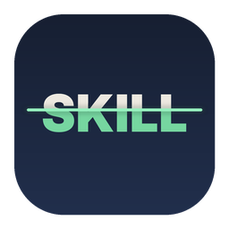

<p align="center"></p>

# Argus · Security checks for AI skills

Before you install a "skill" for Claude or another AI tool, Argus asks several open-source security scanners to check it, then turns what they find into one plain-language report. Everything runs on your own computer: the skill is never uploaded, and no AI key is needed.

The name comes from Argus Panoptes, the hundred-eyed giant of Greek myth: his eyes took turns keeping watch, and never all closed at once.

- For users: [Mac user guide](docs/en/guide-mac.md), [Windows user guide](docs/en/guide-windows.md)
- To add a new scanner: [docs/新增掃描工具.md](docs/新增掃描工具.md) (in Traditional Chinese)

## Scanners included

| Scanner | Author | License | What it checks |
|---|---|---|---|
| [SkillSpector](https://github.com/NVIDIA/SkillSpector) | NVIDIA | Apache-2.0 | Made for AI skills |
| [Cisco Skill Scanner](https://github.com/cisco-ai-defense/skill-scanner) | Cisco AI Defense | Apache-2.0 | Made for AI skills (a second opinion) |
| [Bandit](https://github.com/PyCQA/bandit) | PyCQA | Apache-2.0 | Risky code in Python |
| [Semgrep](https://github.com/semgrep/semgrep) | Semgrep | LGPL-2.1 | Risky code in JavaScript/TypeScript (using Argus's own rules) |
| [detect-secrets](https://github.com/Yelp/detect-secrets) | Yelp | Apache-2.0 | Passwords and keys written into the code |
| [OSV-Scanner](https://github.com/google/osv-scanner) | Google | Apache-2.0 | Known vulnerabilities and malicious packages |

Argus also checks a few things itself: plugin hooks (commands that run automatically) and commands, files bundled with a skill whose contents can't be read, packages that don't pin the version, and MCP server settings.

## Architecture

```
core/argus/            The core, Python standard library only; shared by Mac and, later, Windows
  server.py            Web server that only runs locally (127.0.0.1) and needs a passcode generated at each start
  jobs.py              Runs scans and installs in the background and reports progress
  targets.py           Turns "Claude skills / folder / zip / GitHub" into skill folders to scan (with safe unzipping)
  report.py            Builds a standalone HTML report (opens and can be shared without Argus)
  model.py             The result format shared by all scanners (Finding / Outcome / SkillResult)
  capabilities.py      What it can do: from a skill's code and SKILL.md, whether it goes online, runs programs, writes files, touches secrets
  reviews.py           Reviewed marks and update comparison (file hashes, finding fingerprints, stored only locally)
  mcp.py               MCP server settings check (only reads settings files, never starts a server)
  native.py            The system's folder picker, file picker, and show in Finder (the only platform-specific part)
  cli.py               Command mode: argus scan <target> (for Claude), argus watch (automatic check for new skills)
  integrations.py      Creates the argus command, the argus skill in Claude, the Mac automatic check (LaunchAgent), notifications
  reminder.py          Reminders to check again, and which skills the automatic check should scan
  plugins.py           The parts of a plugin besides skills: hooks, commands, agents and the code they use
  filecheck.py         Files whose contents can't be read, packages that don't pin the version
  scanners/            One file per scanner; adding a file adds a scanner
  ui/                  Web interface (HTML / CSS / JS, no external dependencies)
mac/                   Mac launcher, Info.plist, icon, packaging script
windows/               Windows launcher (Argus.cmd, launch.ps1), icon, packaging script
tests/                 Unit tests, sample output from each scanner, preview server
docs/                  User guides, developer notes
```

**How it runs**: Double-click the app (on Windows, `Argus.cmd` or the Start menu shortcut) → `mac/run`/`windows/launch.ps1` makes sure uv is there → the Python 3.12 that uv sets up starts `python -m argus` in the background → the browser opens. Each scanner is installed into its own environment with `uv tool install`, so their package versions never clash. A few minutes after the page is closed, the server quits by itself.

**Command mode**: Every time Argus starts, it creates an `argus` command in `~/.local/bin` (on Windows, `argus.cmd`) that points to this copy of Argus. `argus scan <folder / zip / GitHub link / claude / mcp>` scans without opening the web page and prints the conclusion and the items worth a look (the same text as the report's "Copy the whole report for Claude to judge"). It also saves an HTML report. The argus skill in Claude simply calls this command.

## Development

```bash
# Unit tests
python3 -m unittest discover tests

# Preview the interface with fake scanners (no need to install the real ones)
python3 tests/preview_server.py        # open the address it prints

# Start it directly (uses the real scanners already installed on this computer)
PYTHONPATH=core python3 -m argus --open

# Package → dist/Argus-mac-<version>.zip, dist/Argus-win-<version>.zip
bash mac/build.sh
bash windows/build.sh
```

Requires Python 3.12 or later.

## What could come next

- Items already noted but not done yet: [docs/待辦.md](docs/待辦.md) (in Traditional Chinese)
- **More scanners**: for example [OSV-Scanner](https://github.com/google/osv-scanner) (package vulnerabilities) and [Semgrep CE](https://github.com/semgrep/semgrep) (code checks for more languages).
- **Optional AI review**: Cisco Skill Scanner and SkillSpector can both use AI to double-check. This could become an advanced option that is off by default and only available with a key.

## Disclaimer

Scan results are for reference only. They don't mean a skill is definitely safe or definitely harmful. Each scanner can only find patterns it already knows, may raise false alarms, and may miss new or deliberately hidden tricks. "Probably fine" is a grouping made by fixed rules and doesn't guarantee there's no problem. Whether to install or use a skill, and how, is your own decision and at your own risk. Argus is provided "as is" under the MIT License, without warranty of any kind, and the author is not liable for any loss from using it or from decisions based on its results. Argus is an independent open-source project. It isn't affiliated with or endorsed by NVIDIA, Cisco, PyCQA, Yelp, Anthropic or any other company or organization.

## License

© 2026 Square Su, open source under the [MIT](LICENSE) License. The included scanners each have their own licenses; see [THIRD_PARTY_NOTICES.md](THIRD_PARTY_NOTICES.md).
