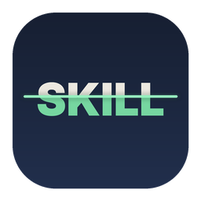

<p align="center"></p>

# Argus · AI スキルのセキュリティスキャン

Claude などの AI ツールに「スキル」（Skill）をインストールする前に、いくつものオープンソースのセキュリティスキャナーでまとめてチェックし、その結果をわかりやすい言葉のレポートにまとめます。表示言語はパソコンの言語に合わせ、ページ右上のテーマ切り替えボタンの横で変えることもできます。すべて自分のパソコンの中で動き、スキルの中身をアップロードすることはありません。AI のキー（API キー）も必要ありません。

名前は、ギリシャ神話に登場する百の目を持つ巨人 Argus Panoptes から取りました。体じゅうの目が交代で見張り、すべての目を閉じることはありません。

- 使う方はこちら：[Mac の使い方](docs/ja/guide-mac.md)、[Windows の使い方](docs/ja/guide-windows.md)
- 新しいスキャナーを追加したい方：[docs/新增掃描工具.md](docs/新增掃描工具.md)（中国語）

## 組み込んでいるスキャナー

| スキャナー | 作者 | ライセンス | 用途 |
|---|---|---|---|
| [SkillSpector](https://github.com/NVIDIA/SkillSpector) | NVIDIA | Apache-2.0 | AI スキル専用のチェック |
| [Cisco Skill Scanner](https://github.com/cisco-ai-defense/skill-scanner) | Cisco AI Defense | Apache-2.0 | AI スキル専用のチェック（セカンドオピニオン） |
| [Bandit](https://github.com/PyCQA/bandit) | PyCQA | Apache-2.0 | Python プログラムの危険な書き方 |
| [Semgrep](https://github.com/semgrep/semgrep) | Semgrep | LGPL-2.1 | JavaScript／TypeScript の危険な書き方（Argus 独自のルールを使用） |
| [detect-secrets](https://github.com/Yelp/detect-secrets) | Yelp | Apache-2.0 | 直接書き込まれたパスワードやキー |
| [OSV-Scanner](https://github.com/google/osv-scanner) | Google | Apache-2.0 | パッケージの既知の脆弱性と悪意のあるパッケージ |

Argus 自身も、プラグインのフック（自動で実行されるコマンド）とコマンド、スキルに含まれる中身の見えないファイル、バージョンが固定されていないパッケージ、MCP サーバーの設定をチェックします。

## 構成

```
core/argus/            コア。Python の標準ライブラリだけを使用。Mac と今後の Windows で共通
  server.py            ローカル（127.0.0.1）だけで動く Web サーバー。起動のたびに生成するパスコードが必要
  jobs.py              スキャンとインストールをバックグラウンドで実行し、進み具合を返す
  targets.py           「Claude のスキル／フォルダ／zip／GitHub」をスキャン対象のスキルフォルダにする（安全な展開を含む）
  report.py            単体で開ける HTML レポートを作る（Argus がなくても開ける・共有できる）
  model.py             すべてのスキャナーで共通の結果の形式（Finding / Outcome / SkillResult）
  capabilities.py      できることの一覧：スキルのプログラムと SKILL.md から、ネット接続・プログラム実行・ファイル書き込み・秘密情報へのアクセスの有無を判断
  reviews.py           確認済みの記録と更新の比較（ファイルのハッシュ、指摘のフィンガープリント。ローカルにだけ保存）
  mcp.py               MCP サーバーの設定チェック（設定ファイルを読むだけで、サーバーは起動しない）
  native.py            OS のフォルダ選択・ファイル選択、Finder で開く（OS に依存する唯一の部分）
  cli.py               コマンドモード：argus scan <対象>（Claude 用）、argus watch（新しいスキルを自動チェック）
  integrations.py      argus コマンド、Claude 内の argus スキル、Mac の自動チェック（LaunchAgent）、通知を作る
  reminder.py          チェックし直しのお知らせと、自動チェックでスキャンするスキルの選定
  plugins.py           プラグインのうちスキル以外の部分：フック、コマンド、エージェントと、それらが使うプログラム
  filecheck.py         中身の見えないファイル、バージョンが固定されていないパッケージ
  scanners/            スキャナーごとに 1 ファイル。ファイルを足せばスキャナーが増える
  ui/                  Web 画面（HTML / CSS / JS。外部への依存なし）
mac/                   Mac のランチャー、Info.plist、アイコン、パッケージ作成スクリプト
windows/               Windows のランチャー（Argus.cmd、launch.ps1）、アイコン、パッケージ作成スクリプト
tests/                 単体テスト、各スキャナーの出力サンプル、プレビュー用サーバー
docs/                  使い方、開発者向けドキュメント
```

**動作の流れ**：アプリをダブルクリック（Windows では `Argus.cmd` またはスタートメニューのショートカット）→ `mac/run`／`windows/launch.ps1` が uv があるか確認 → uv が用意した Python 3.12 でバックグラウンドに `python -m argus` を起動 → ブラウザを開きます。スキャナーはそれぞれ `uv tool install` で独立した環境にインストールされるので、パッケージのバージョンがぶつかることはありません。ページを閉じて数分経つと、サーバーは自動で終了します。

**コマンドモード**：Argus は起動するたびに `~/.local/bin` に `argus` コマンド（Windows では `argus.cmd`）を作り、この Argus を指すようにします。`argus scan <フォルダ／zip／GitHub の URL／claude／mcp>` を使うと、Web ページを開かずに直接スキャンし、結論と確認したほうがよい点を表示します（レポートの「レポート全体を Claude に判断してもらう（コピー）」と同じ文章です）。HTML レポートも保存します。Claude 内の argus スキルは、このコマンドを呼び出しています。

## 開発

```bash
# 単体テスト
python3 -m unittest discover tests

# ダミーのスキャナーで画面をプレビュー（本物のスキャナーのインストールは不要）
python3 tests/preview_server.py        # 表示される URL を開く

# 直接起動（パソコンにインストール済みの本物のスキャナーを使う）
PYTHONPATH=core python3 -m argus --open

# パッケージ作成 → dist/Argus-mac-<バージョン>.zip、dist/Argus-win-<バージョン>.zip
bash mac/build.sh
bash windows/build.sh
```

Python 3.12 以降が必要です。

## 今後やれること

- 記録済みで未着手の項目：[docs/待辦.md](docs/待辦.md)（中国語）
- **スキャナーを増やす**：たとえば [OSV-Scanner](https://github.com/google/osv-scanner)（パッケージの脆弱性）、[Semgrep CE](https://github.com/semgrep/semgrep)（より多くの言語のプログラムチェック）。
- **オプションの AI 判定**：Cisco Skill Scanner と SkillSpector は、どちらも AI でもう一度確かめる機能に対応しています。「キーがあるときだけ使える、初期設定ではオフ」の上級者向けオプションにできます。

## 免責事項

スキャン結果は参考情報です。スキルが必ず安全である、または必ず有害であることを示すものではありません。各スキャナーが見つけられるのは既知の書き方だけで、誤検知することもあれば、新しい手口や意図的に隠された手口を見逃すこともあります。「たぶん心配なし」は決まったルールによるグループ分けで、問題がないことを保証するものではありません。インストールするかどうか、どう使うかはご自身で判断し、そのリスクもご自身で負ってください。Argus は MIT ライセンスのもと「現状のまま」提供され、いかなる保証もありません。作者は、本ツールの使用や、その結果にもとづく判断によって生じたいかなる損害についても責任を負いません。Argus は独立したオープンソースプロジェクトであり、NVIDIA、Cisco、PyCQA、Yelp、Anthropic などの企業や団体とは関係がなく、その承認も受けていません。

## ライセンス

© 2026 Square Su。[MIT](LICENSE) ライセンスで公開しています。組み込んでいるスキャナーには、それぞれのライセンスが適用されます。[THIRD_PARTY_NOTICES.md](THIRD_PARTY_NOTICES.md) をご覧ください。
