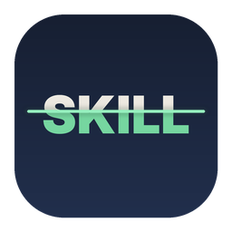

<p align="center"></p>

# Argus · AI 스킬 보안 검사

Claude 같은 AI 도구에 '스킬'(Skill)을 설치하기 전에, 여러 오픈소스 보안 스캐너로 함께 검사하고 그 결과를 알기 쉬운 보안 보고서 한 장으로 정리해 줘요. Argus는 컴퓨터의 언어를 따라가고, 페이지 오른쪽 위의 테마 전환 버튼 옆에서 언어를 바꿀 수 있어요. 모든 작업은 내 컴퓨터에서 이루어지고, 스킬 내용을 업로드하지 않으며, AI 키(API 키)도 필요 없어요.

이름은 그리스 신화에 나오는 눈이 백 개 달린 거인 아르고스 파놉테스(Argus Panoptes)에서 따왔어요. 몸에 달린 눈이 번갈아 지켜보기 때문에 모든 눈을 한꺼번에 감는 일이 없어요.

- 사용하는 분은 여기를 봐 주세요: [Mac 사용 설명서](docs/ko/guide-mac.md), [Windows 사용 설명서](docs/ko/guide-windows.md)
- 새 스캐너를 추가하고 싶다면: [docs/新增掃描工具.md](docs/新增掃描工具.md) (중국어)

## 지금 함께 쓰는 스캐너

| 스캐너 | 만든 곳 | 라이선스 | 용도 |
|---|---|---|---|
| [SkillSpector](https://github.com/NVIDIA/SkillSpector) | NVIDIA | Apache-2.0 | AI 스킬 전용 검사 |
| [Cisco Skill Scanner](https://github.com/cisco-ai-defense/skill-scanner) | Cisco AI Defense | Apache-2.0 | AI 스킬 전용 검사 (두 번째 의견) |
| [Bandit](https://github.com/PyCQA/bandit) | PyCQA | Apache-2.0 | Python 코드의 위험한 패턴 |
| [Semgrep](https://github.com/semgrep/semgrep) | Semgrep | LGPL-2.1 | JavaScript/TypeScript 코드의 위험한 패턴 (Argus 자체 규칙 사용) |
| [detect-secrets](https://github.com/Yelp/detect-secrets) | Yelp | Apache-2.0 | 코드에 그대로 적힌 비밀번호와 키 |
| [OSV-Scanner](https://github.com/google/osv-scanner) | Google | Apache-2.0 | 패키지의 알려진 취약점과 악성 패키지 |

Argus도 직접 검사해요: 플러그인의 훅(자동으로 실행되는 명령)과 명령, 스킬에 딸린 내용을 볼 수 없는 파일, 버전 고정이 안 된 패키지, 그리고 MCP 서버 설정.

## 구조

```
core/argus/            핵심. Python 표준 라이브러리만 사용하고, Mac과 Windows가 함께 써요
  server.py            내 컴퓨터(127.0.0.1)에서만 작동하는 웹 서버. 실행할 때마다 만드는 접속 코드가 필요해요
  jobs.py              검사와 설치를 백그라운드에서 실행하고 진행 상황을 알려 줘요
  targets.py           'Claude 스킬/폴더/zip/GitHub'를 검사할 스킬 폴더로 바꿔요 (안전한 압축 풀기 포함)
  report.py            독립된 HTML 보고서를 만들어요 (Argus 없이도 열고 공유할 수 있어요)
  model.py             모든 스캐너가 함께 쓰는 결과 형식 (Finding / Outcome / SkillResult)
  capabilities.py      할 수 있는 일 한눈에 보기: 스킬의 코드와 SKILL.md를 보고 인터넷 연결, 프로그램 실행, 파일 쓰기, 비밀 정보 접근 여부를 판단해요
  reviews.py           확인함 표시와 업데이트 비교 (파일 해시, 발견 항목 지문. 내 컴퓨터에만 저장해요)
  mcp.py               MCP 서버 설정 검사 (설정 파일만 읽고, 서버는 실행하지 않아요)
  native.py            시스템의 폴더 선택, 파일 선택, Finder에서 열기 (운영체제에 따라 달라지는 유일한 부분)
  cli.py               명령 모드: argus scan <대상> (Claude용), argus watch (새 스킬 자동 검사)
  integrations.py      argus 명령, Claude 안의 argus 스킬, Mac의 자동 검사(LaunchAgent), 알림을 만들어요
  reminder.py          다시 검사하라는 알림, 그리고 자동 검사에서 어떤 스킬을 검사할지 정해요
  plugins.py           플러그인에서 스킬이 아닌 부분: 훅, 명령, 에이전트와 그것들이 쓰는 프로그램
  filecheck.py         내용을 볼 수 없는 파일, 버전 고정이 안 된 패키지
  scanners/            스캐너마다 파일 하나. 파일을 추가하면 스캐너가 추가돼요
  ui/                  웹 화면 (HTML / CSS / JS, 외부 의존성 없음)
mac/                   Mac 실행기, Info.plist, 아이콘, 패키징 스크립트
windows/               Windows 실행기(Argus.cmd, launch.ps1), 아이콘, 패키징 스크립트
tests/                 단위 테스트, 스캐너별 출력 예시, 미리 보기용 서버
docs/                  사용 설명서, 개발 설명서
```

**실행 흐름**: 앱을 더블 클릭(Windows는 `Argus.cmd` 또는 시작 메뉴의 바로 가기) → `mac/run`/`windows/launch.ps1`이 uv가 있는지 확인 → uv가 준비한 Python 3.12로 백그라운드에서 `python -m argus` 실행 → 브라우저 열기. 스캐너는 각각 `uv tool install`로 독립된 환경에 설치되기 때문에 서로 패키지 버전이 부딪히지 않아요. 페이지를 닫고 몇 분이 지나면 서버가 저절로 종료돼요.

**명령 모드**: Argus는 실행할 때마다 `~/.local/bin`에 `argus` 명령(Windows는 `argus.cmd`)을 만들고, 이 Argus를 가리키게 해요. `argus scan <폴더/zip/GitHub 주소/claude/mcp>`는 웹 페이지를 열지 않고 바로 검사해서, 결론과 확인할 항목을 출력해요. (보고서의 '보고서 전체를 Claude에게 판단 맡기기(복사)'와 같은 텍스트예요.) HTML 보고서도 한 부 저장해요. Claude 안의 argus 스킬은 바로 이 명령을 불러요.

## 개발

```bash
# 단위 테스트
python3 -m unittest discover tests

# 가짜 스캐너로 화면 미리 보기 (실제 스캐너를 설치하지 않아도 돼요)
python3 tests/preview_server.py        # 출력된 주소를 열어요

# 바로 실행 (컴퓨터에 이미 설치된 실제 스캐너를 써요)
PYTHONPATH=core python3 -m argus --open

# 패키징 → dist/Argus-mac-<버전>.zip, dist/Argus-win-<버전>.zip
bash mac/build.sh
bash windows/build.sh
```

Python 3.12 이상이 필요해요.

## 앞으로 할 수 있는 일

- 적어 두었지만 아직 하지 않은 항목: [docs/待辦.md](docs/待辦.md) (중국어)
- **스캐너 더 추가**: 예를 들어 [OSV-Scanner](https://github.com/google/osv-scanner)(패키지 취약점), [Semgrep CE](https://github.com/semgrep/semgrep)(더 많은 언어의 코드 검사).
- **선택 사항인 AI 판단**: Cisco Skill Scanner와 SkillSpector는 둘 다 AI로 한 번 더 확인하는 기능을 지원해요. '키가 있을 때만 켜고, 기본값은 꺼짐'인 고급 옵션으로 만들 수 있어요.

## 면책 조항

검사 결과는 참고용이며, 스킬이 반드시 안전하다거나 반드시 해롭다는 뜻이 아니에요. 각 스캐너는 알려진 패턴만 찾을 수 있어서 오탐이 있을 수 있고, 새롭거나 일부러 숨긴 수법은 놓칠 수도 있어요. '대체로 괜찮음'은 정해진 규칙에 따라 나눈 묶음일 뿐, 문제가 없다는 보장은 아니에요. 설치할지, 어떻게 쓸지는 스스로 판단하고 그 위험도 직접 책임져야 해요. Argus는 MIT 라이선스에 따라 '있는 그대로' 제공되며 어떤 보증도 하지 않아요. 만든 사람은 이 도구를 쓰거나 결과를 바탕으로 내린 결정으로 생긴 어떤 손해에도 책임지지 않아요. Argus는 독립적인 오픈소스 프로젝트로, NVIDIA, Cisco, PyCQA, Yelp, Anthropic 등 어떤 회사나 조직과도 관계가 없고 그들의 보증을 받지도 않았어요.

## 라이선스

© 2026 Square Su. [MIT](LICENSE) 라이선스로 공개된 오픈소스예요. 함께 쓰는 스캐너에는 각자의 라이선스가 적용돼요. [THIRD_PARTY_NOTICES.md](THIRD_PARTY_NOTICES.md)를 봐 주세요.
