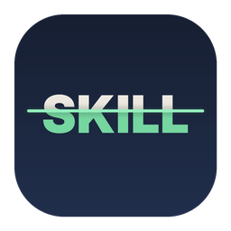

<p align="center"></p>

# Argus · AI 技能安全掃描

在安裝 Claude 等 AI 工具的「技能」（Skill）之前，請好幾個開源安全掃描工具一起檢查，再把結果整理成一份白話中文報告。全部在自己的電腦上執行，不上傳技能內容，也不需要 AI 金鑰。

名字來自希臘神話裡的百眼巨人 Argus Panoptes：身上的眼睛輪流守望，從不全部閉上。

- 使用者請看：[Mac 使用說明](docs/使用說明.md)、[Windows 使用說明](docs/使用說明-Windows.md)
- 想加入新的掃描工具：[docs/新增掃描工具.md](docs/新增掃描工具.md)

## 目前整合的工具

| 工具 | 作者 | 授權 | 用途 |
|---|---|---|---|
| [SkillSpector](https://github.com/NVIDIA/SkillSpector) | NVIDIA | Apache-2.0 | 專門檢查 AI 技能 |
| [Cisco Skill Scanner](https://github.com/cisco-ai-defense/skill-scanner) | Cisco AI Defense | Apache-2.0 | 專門檢查 AI 技能（第二意見） |
| [Bandit](https://github.com/PyCQA/bandit) | PyCQA | Apache-2.0 | Python 程式的危險寫法 |
| [Semgrep](https://github.com/semgrep/semgrep) | Semgrep | LGPL-2.1 | JavaScript／TypeScript 的危險寫法（用 Argus 自己的規則） |
| [detect-secrets](https://github.com/Yelp/detect-secrets) | Yelp | Apache-2.0 | 寫死的密碼與金鑰 |
| [OSV-Scanner](https://github.com/google/osv-scanner) | Google | Apache-2.0 | 套件的已知漏洞和惡意套件 |

## 架構

```
core/argus/            核心，只用 Python 標準函式庫；Mac 和之後的 Windows 共用
  server.py            只在本機（127.0.0.1）運作的網頁伺服器，需要每次啟動產生的通行碼
  jobs.py              在背景執行掃描和安裝，提供進度
  targets.py           把「Claude 技能／資料夾／zip／GitHub」變成要掃的技能資料夾（含安全解壓縮）
  report.py            產生獨立的 HTML 報告（不靠 Argus 也能打開、分享）
  model.py             所有工具共用的結果格式（Finding / Outcome / SkillResult）
  capabilities.py      能力一覽：從技能的程式和 SKILL.md 判斷它會不會連網、執行程式、寫檔、碰觸機密
  reviews.py           已看過和更新比對（檔案雜湊、發現指紋，只存在本機）
  mcp.py               MCP 伺服器設定檢查（只讀設定檔，不啟動伺服器）
  native.py            系統的選資料夾、選檔案、在 Finder 打開（唯一跟平台有關的地方）
  scanners/            每個掃描工具一個檔案；加檔案就是加工具
  ui/                  網頁介面（HTML / CSS / JS，沒有外部相依）
mac/                   Mac 啟動器、Info.plist、圖示、打包腳本
windows/               Windows 啟動器（Argus.cmd、launch.ps1）、圖示、打包腳本
tests/                 單元測試、各工具輸出的範例、預覽用伺服器
docs/                  使用說明、開發說明
```

**執行流程**：點兩下 App（Windows 是 `Argus.cmd` 或開始功能表的捷徑）→ `mac/run`／`windows/launch.ps1` 確認有 uv → 用 uv 準備的 Python 3.12 在背景啟動 `python -m argus` → 打開瀏覽器。掃描工具各自用 `uv tool install` 裝成獨立環境，彼此的套件版本不會打架。頁面關掉幾分鐘後，伺服器自動結束。

## 開發

```bash
# 單元測試
python3 -m unittest discover tests

# 用假的掃描工具預覽介面（不用安裝真的工具）
python3 tests/preview_server.py        # 打開它印出的網址

# 直接啟動（會用到電腦上已經裝好的真工具）
PYTHONPATH=core python3 -m argus --open

# 打包 → dist/Argus-mac-<版本>.zip、dist/Argus-win-<版本>.zip
bash mac/build.sh
bash windows/build.sh
```

需要 Python 3.12 以上。

## 接下來可以做的

- 已經記下來、還沒做的項目：[docs/待辦.md](docs/待辦.md)
- **更多工具**：例如 [OSV-Scanner](https://github.com/google/osv-scanner)（套件漏洞）、[Semgrep CE](https://github.com/semgrep/semgrep)（更多語言的程式檢查）。
- **選配的 AI 判斷**：Cisco Skill Scanner 和 SkillSpector 都支援用 AI 再確認一次，可以做成「有金鑰才開、預設關閉」的進階選項。

## 免責聲明

掃描結果僅供參考，不代表技能一定安全或一定有害。各掃描工具只能找出已知的寫法，可能誤判，也可能漏掉新的或刻意隱藏的手法；「多半不用擔心」是依固定規則分的組，不代表一定沒問題。是否安裝、如何使用，由你自行判斷並承擔風險。Argus 依 MIT 授權「按現狀」提供，不附任何保證，作者不對使用本工具或依結果所做的決定造成的任何損失負責。Argus 是獨立的開源專案，與 NVIDIA、Cisco、PyCQA、Yelp、Anthropic 等公司或組織無關，也沒有獲得它們的背書。

## 授權

© 2026 Square Su，以 [MIT](LICENSE) 授權開源。整合的掃描工具各自適用自己的授權，見 [THIRD_PARTY_NOTICES.md](THIRD_PARTY_NOTICES.md)。
